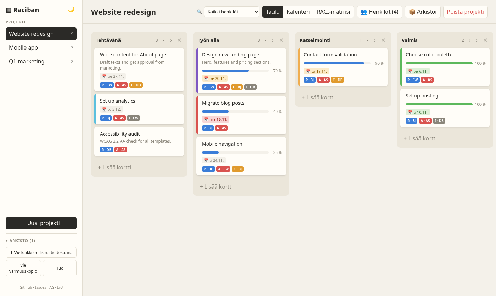
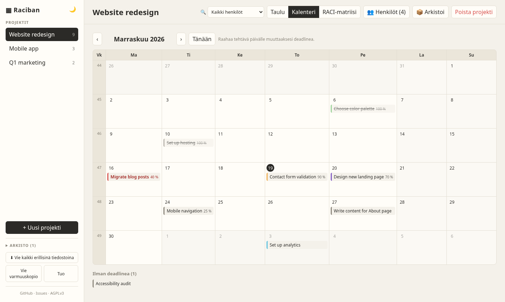
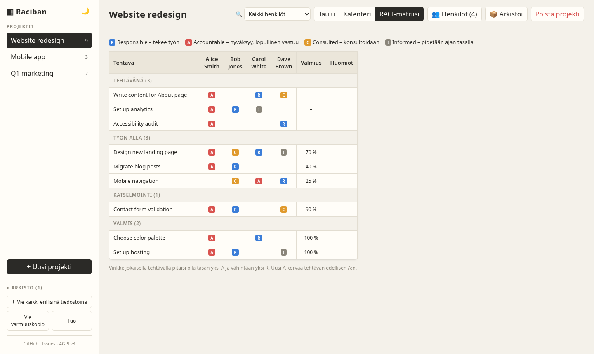

# Raciban

A kanban board with built-in RACI responsibilities, in a single HTML file. No install, no server, no account.

## Features

- Multiple projects, each with its own kanban board
- RACI roles (Responsible, Accountable, Consulted, Informed) for tasks, plus a RACI matrix view
- Deadlines, completion percentage and a monthly calendar view
- Task priorities (P0–P4)
- Gantt view with task dependencies: drag a task onto another to make it a predecessor; unfinished kanban columns are ordered so predecessors come first
- Shared people across projects, with notes and a search over names, notes, projects and tasks
- Person filter
- Search across tasks by title, description, column, people and roles (e.g. `A:Matti`), priority, deadline and progress; press `/` to focus
- Task archiving: archive single tasks or the whole done column, then restore or delete them from the Archived view
- Project archiving, with each archived project saved as a separate JSON file
- JSON export and import
- Light and dark theme

| Calendar | RACI matrix |
|---|---|
|  |  |

## Usage

Open `index.html` in your browser.

Data is stored in your browser's `localStorage`. Export a backup regularly.

## License

[GNU AGPLv3](LICENSE)
